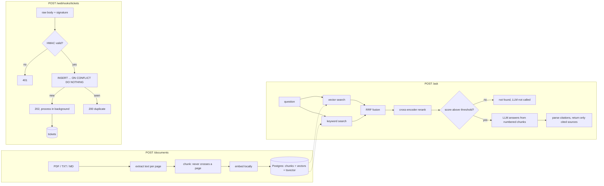

# AI Docs Assistant

A small backend that does two things: it answers questions from documents you upload (PDF, TXT,
Markdown) and cites the file and page for every answer, and it receives signed ticket webhooks
and stores them safely, even when the same event is delivered twice.

Stack: FastAPI, PostgreSQL + pgvector (one database for everything), local embedding and
reranking models (no API key needed for them), and any OpenAI-compatible LLM for the final answer.

**Live demo (until 1 November 2026):** http://13.234.23.126:8000/docs. It is one small EC2 server
running this same `docker compose` stack, plain HTTP and no login, so please do not upload anything
sensitive. Uploads are limited to 20 MB and 200 pages. Webhook calls need the signing secret, which I
can share on request.



## Run locally

Requirements: Docker. (To run the tests or the evaluation outside Docker you also need Python.)

```bash
cp .env.example .env
# edit .env: set WEBHOOK_SECRET to any random string, and LLM_API_KEY
docker compose up --build
```

Open <http://localhost:8000/docs> for the interactive API. The first request that uses the models
downloads them (roughly 100-200 MB) into a Docker volume, so it is slow once and fast afterwards.

**LLM provider.** The default in `.env.example` is Groq's free tier. Any OpenAI-compatible
endpoint works by changing three variables, for example Anthropic's compatibility endpoint:

```
LLM_BASE_URL=https://api.anthropic.com/v1/
LLM_API_KEY=<your key>
LLM_MODEL=claude-haiku-5-5
```

Some newer models reject the `temperature` parameter; the client detects that and stops sending it.

**Try it:**

```bash
# upload a document
curl -F "file=@handbook.pdf;type=application/pdf" http://localhost:8000/documents

# ask a question
curl -X POST http://localhost:8000/ask -H "Content-Type: application/json" \
     -d '{"question": "How often must passwords be rotated?"}'

# send a signed webhook (uses WEBHOOK_SECRET from your environment)
export WEBHOOK_SECRET=<same value as in .env>
python scripts/send_webhook.py --event-id evt_101 --title "Login fails" --priority high
python scripts/send_webhook.py --event-id evt_101 --title "Login fails" --priority high   # duplicate
python scripts/send_webhook.py --event-id evt_102 --bad-signature                          # 401
curl http://localhost:8000/tickets
```

The webhook signature goes in the `X-Signature` header (`sha256=<hex>` or plain hex) and is the
HMAC-SHA256 of the exact request body bytes.

**`/ask` options:** `retrieval` (`vector`, `keyword`, `hybrid`; default `hybrid`), `rerank`
(default `true`), `hyde` (default `false`), `top_k` (default 5, max 20). The response's `debug`
block shows what ran, the score the relevance gate looked at, and the latency.

**Tests:**

```bash
docker compose up db -d          # Postgres on host port 5433
pip install -r requirements-dev.txt
pytest -q
```

Tests run against a real Postgres (a separate `docs_test` database is created automatically) and
use fake embedder, reranker and LLM classes, so they never download a model or call an API.
`ruff check .` runs the linter. GitHub Actions runs both on every push.

**Evaluation:** `python eval/make_sample_docs.py` then `python eval/run_eval.py` (needs the
database from `docker compose up db -d`; uses a separate `docs_eval` database). It prints the
results and also writes them to `eval/results.md` (a generated file, not committed).

## Design choices and why

**Chunking: about 2,000 characters, 300 overlap, never across a page.** 2,000 characters is
roughly 400-500 tokens: big enough to hold a complete idea, small enough that retrieval stays
precise and five chunks fit easily in the prompt. Chunks never cross a page boundary, so every
citation names exactly one page. Sentences are packed greedily; the last ~300 characters carry
into the next chunk so an idea split across a boundary is still found. Hyphenated line breaks are
repaired, over-long sentences are hard-split, and fragments under 50 characters (page numbers,
headers) are dropped. Text and Markdown files are treated as a single page 1.

**Embeddings: `BAAI/bge-small-en-v1.5` through fastembed.** 384 dimensions, runs locally on ONNX
(no PyTorch, small image, no API key or per-call cost) and is strong for its size. The model is
loaded once per process, not per request. Note: in the installed fastembed version
`query_embed` does not add bge's optional query instruction, so queries are embedded as plain text.

**pgvector, one database for everything.** Tickets, webhook events, chunks, vectors and the
keyword index live in one Postgres, so ingestion is a single transaction (a document and all its
chunks are saved together or not at all) and there is no second service to run. At this scale an
HNSW index is more than enough; a dedicated vector database would only add operations work.

**Hybrid retrieval, fused with RRF, then reranked.** Vector search finds paraphrases; keyword
search (Postgres full-text, `ts_rank_cd`) finds exact terms such as `E-4012`. The keyword query is
an OR of the question's terms, because `plainto_tsquery` ANDs every word and a natural question
then matches nothing. Their ranked lists are fused with Reciprocal Rank Fusion
(`score = sum of 1/(60 + rank)`), which uses only rank positions, so cosine similarity and
`ts_rank` never need to be put on one scale. The fused top 20 are rescored by a cross-encoder
(`ms-marco-MiniLM-L-6-v2`) that reads question and chunk together, and only the best `top_k`
(default 5) go to the LLM. Sending fewer, better chunks gives tighter answers than sending 20.

**Relevance gate before the LLM.** If the best score is too low, `/ask` returns "I couldn't find
this in the uploaded documents." without calling the model: cheaper, faster, and it cannot make
something up from irrelevant text. With reranking on, the gate is the top cross-encoder score
(`RERANK_SCORE_THRESHOLD`); otherwise it is the best vector similarity (`VECTOR_SIMILARITY_FLOOR`).
As a second line of defence the prompt tells the model to answer exactly `NOT_FOUND` when the
context lacks the answer, and that sentinel is mapped to the same not-found response.

**Citations.** The prompt numbers the chunks `[1]..[n]` and requires inline citations. The
response's `sources` contain only chunks the model actually cited (numbers that do not exist are
ignored; duplicates on the same page are merged). If the model cites nothing, all supplied chunks
are returned with `citations_missing: true`. The prompt also states that the context is data and
any instructions inside it must be ignored (prompt-injection guard).

**Webhook security and idempotency.** The signature is checked on the raw request bytes before any
JSON parsing, because re-serialising JSON changes the bytes. `hmac.compare_digest` compares in
constant time so response timing leaks nothing about the expected value. The server refuses to
start with an empty `WEBHOOK_SECRET`. Idempotency does not rely on "check, then insert": the
`event_id` is the primary key and the claim is `INSERT ... ON CONFLICT DO NOTHING RETURNING`, so
even two identical requests at the same instant produce exactly one winner. A failed event is not
lost: redelivering it flips `failed` back to `received` (also atomically) and reprocesses it.

**BackgroundTasks, and their limits.** The endpoint answers fast (`202`) and does the work after
the response, in its own database session. That is simple and easy to explain, but the task lives
in the web process: if the process dies mid-task, the event stays `received` and nothing retries
it. A durable queue fixes that (see improvements).

**OpenAI-compatible LLM client.** One small class using the `openai` SDK with a configurable base
URL. Switching between Groq, Gemini, Ollama, OpenAI or Anthropic's compatibility endpoint is a
change of environment variables, not code.

**Other notes.** Tables are created on startup (no Alembic; fine for this project, see
improvements). Upload endpoints are plain `def`, so FastAPI runs the CPU-bound embedding in a
threadpool instead of blocking the event loop. Uploads are deduplicated by SHA-256, validated by
extension, content type and (for PDFs) the `%PDF` header, and capped at `MAX_UPLOAD_MB` (20 MB, `413`) and `MAX_PAGES` (200 pages, `413`) so one upload cannot tie up the server; both limits are returned to the caller in the error message.

## Evaluation results

Ten questions (4 exact-term, 4 paraphrased, 2 unanswerable) over three sample documents (a 7-page
handbook, an 8-page engineering playbook made of look-alike decoy pages, and a product FAQ full
of error codes). `top_k=5`; hit@1 means the correct (file, page) was the first chunk returned.
The script's full output also includes a per-question rank table and the score calibration.

| Config | hit@1 | hit@5 | MRR | unanswerable rejected | answerable wrongly rejected | retrieval ms |
|---|---|---|---|---|---|---|
| vector | 4/8 | 8/8 | 0.75 | 0/2 | 0/8 | 37 |
| keyword | 4/8 | 7/8 | 0.65 | 0/2 | 0/8 | 5 |
| hybrid (RRF) | 4/8 | 8/8 | 0.72 | 0/2 | 0/8 | 43 |
| hybrid + rerank | 5/8 | 8/8 | 0.81 | 1/2 | 0/8 | 1101 |
| hybrid + rerank + HyDE | 5/8 | 8/8 | 0.81 | 1/2 | 0/8 | 3256 |

What this shows, honestly: the set is small (8 answerable questions), so treat it as a
sanity check, not a benchmark.

- Every technique finds the right page within the top 5 (7 or 8 of 8), so the correct chunk is
  nearly always available; the differences are in how high it is ranked.
- Reranking is the one change that clearly helped: one more correct first result and the best MRR.
  It costs about one second per question on CPU, which is why it is on by default but switchable.
- Hybrid fusion did **not** beat plain vector search here. Keyword search with a natural-language
  question matches many generic words ("error", "mean"), so a decoy page full of those words can
  outrank the page with the exact code. Keyword search earns its place as a second opinion for
  identifiers, not as a standalone retriever (its MRR is the lowest).
- **HyDE:** no measurable gain on this set, for roughly 2 extra seconds and one extra LLM call per
  question. The corpus is small and the questions are already close to the document wording, so
  there was little for HyDE to fix. It stays off by default. It is still plausible that it helps
  on large corpora with vague questions, but this evaluation does not show it. When enabled, its
  passage only adds an extra vector list; the original question is still what the reranker and the
  gate see, so a fluent invented answer cannot make an unanswerable question look answerable.

**Calibrated defaults.** The cross-encoder score on this set ranged from -6.8 to +8.9 for
answerable questions and from -3.8 to -11.2 for the two unanswerable ones, so the groups overlap
and no threshold separates them perfectly (the in-domain-but-missing "parental leave" question
scores higher than the awkwardly-worded "alert" question). I chose `RERANK_SCORE_THRESHOLD=-8.0`:
below every answerable score, so a real question is never refused by the gate, and it still
rejects clearly unrelated questions (the stock-option question scored -11.2). Borderline questions
that pass the gate are caught by the model's `NOT_FOUND` rule instead. Choosing recall over
precision at the gate is deliberate: a wrongly refused real question is a worse failure than one
extra LLM call. `VECTOR_SIMILARITY_FLOOR=0.5` only separates off-topic questions (an unrelated
question like "capital of France" scored about 0.4 with real embeddings); in-domain questions
score 0.6-0.8 whether or not the answer exists.

## Deploying on AWS (and a GCP alternative)

**All prices below are rough estimates, not quotes.** My lookups could not confirm official
regional list prices for ap-south-1 (Mumbai) or asia-south1, so I used published us-east-1 rates
and general figures as a base. Mumbai is typically somewhat more expensive. Check the AWS and GCP
pricing calculators for your region before committing. Assumptions: one always-on application
task, low traffic (a few thousand requests a month), 20 GB database storage, public subnets with
security groups (no NAT gateway), LLM usage billed separately.

**AWS**

| Piece | Choice | Approx. monthly |
|---|---|---|
| App | ECS Fargate, 1 vCPU / 2 GB (the models need memory), one task, behind an ALB | ~$35-40 |
| Load balancer | Application Load Balancer | ~$18-22 |
| Database | RDS PostgreSQL `db.t4g.micro` with the pgvector extension, 20 GB gp3 | ~$17-20 |
| Files | S3 for the original uploads (not stored today; add on upload) | ~$1 |
| Secrets, logs | Secrets Manager for `WEBHOOK_SECRET` and the LLM key; CloudWatch Logs | ~$3-8 |
| Webhooks at scale | SQS between the endpoint and a worker | pennies at low volume |

Total: roughly **$75-100 per month** plus LLM usage. The container image is built from this
repo's Dockerfile and pushed to ECR; the model cache should live on an EFS volume or be baked
into the image so cold starts do not re-download models. Put the task in two availability zones
only when uptime matters; a single `db.t4g.micro` is a single point of failure.

**GCP alternative.** Cloud Run (1 vCPU / 2 GiB, minimum one instance so the models stay loaded)
plus Cloud SQL for PostgreSQL (a shared-core or `db-g1-small` instance with pgvector) comes to
roughly **$70-95 per month** at the same assumptions: no load balancer to pay for and simpler
operations, but with the minimum instance always on it is not dramatically cheaper than AWS. Letting Cloud Run scale to zero would be cheaper
at very low traffic, at the cost of a slow first request while the models load.

## What I would improve with more time

- **Durable webhook processing:** an SQS queue (or Celery/Redis) with retries and a dead-letter
  queue instead of `BackgroundTasks`, so a crashed process cannot strand an event.
- **Alembic migrations** instead of `create_all` on startup.
- **Asynchronous ingestion** with job status polling, so large PDFs do not hold an HTTP request.
- **OCR** for scanned PDFs (today they are rejected with a clear 422).
- **Authentication and per-tenant isolation** of documents and tickets.
- **Streaming answers** to the client as they are generated.
- **Better chunking and keyword search:** structure-aware chunks (headings, tables); weighting
  identifier-like tokens (anything containing a digit) in the keyword query, which would likely
  have fixed the E-4012 ranking above.
- **Long structured documents:** PageIndex-style tree navigation (read the table of contents, then
  descend to the right section), and an RLM-style "deep mode" with restricted tools for
  corpus-wide questions that no single chunk can answer ("list every approval threshold").
- **Observability:** retrieval traces (what was retrieved, scores, what the model cited) per request.
- **A larger evaluation set** with answer-quality grading, not only retrieval hit rates, and
  confidence intervals so small differences are not over-read.
